# Event Registration & Live Lucky Draw System Blueprint

## 1. Executive Summary & Layman Workflow

This document outlines the complete operational and technical design for an end-to-end event registration, gate check-in, and interactive lucky draw system designed for **3,000+ attendees**.

The setup is optimized to be **ultra-cost-effective (under $15 total)**, crash-proof under heavy gate traffic, and split across two independent web links so the stage display remains completely decoupled from registration.

---

### Layman Flowchart

```mermaid
flowchart TD
    subgraph Step 1: Registration
        A[Visitor Scans Welcome QR] --> B[Registration Web Form Opens]
        B --> C[Visitor Enters Details & WhatsApp No.]
        C --> D{Is WhatsApp Valid?}
        D -- No --> E[On-screen Error: Please provide valid WhatsApp]
        D -- Yes --> F[Saved to System & Excel Sync]
        F --> G[Instant WhatsApp Ticket sent with Unique QR Code]
    end

    subgraph Step 2: Gate Check-in
        H[Visitor Reaches Gate] --> I[Volunteer Scans Visitor QR with Phone Camera]
        I --> J{Valid & Unused?}
        J -- Already Scanned --> K[Red Screen: QR Already Expired / Used]
        J -- Valid --> L[Green Screen: Checked-In!]
        L --> M[Marked 'Visited' in Excel & Eligible for Lucky Draw]
    end

    subgraph Step 3: Big Screen Lucky Draw
        N[Stage Admin Opens Separate Lucky Draw URL] --> O[System selects 100 Random Unpicked Visitors]
        O --> P[10x10 Animated Grid Appears on Stage Screen]
        P --> Q[Host Hits 'Start Draw' - Highlight Box Races Across Grid for 10s]
        Q --> R[Highlight Box Stops on 1 Winner!]
        R --> S[Winner Announced - Removed from Future Pool]
    end
```



---

## 2. Step-by-Step Operational Breakdown

### Step 1: Registration (Visitor Facing)
1. Physical standees or roll-up banners display a prominent QR code linked to `register.yourevent.com` (or a free Vercel subdomain).
2. The user submits:
   - Full Name
   - WhatsApp Number
   - Organization / Email / City (optional custom fields)
3. Upon pressing **Register**:
   - The system checks if the WhatsApp number has the correct country code and format.
   - A unique 8-character alphanumeric ticket code and secure cryptotoken are assigned (e.g., `EVT-84920`).
   - A personalized digital pass with an embedded QR code is dispatched to their WhatsApp inbox.

### Step 2: Excel & Data Storage Handling
> **Important Technical Note on Excel:**
> Storing data *only* in an active `.xlsx` file on a shared drive will crash or lock up when 5 gate staff simultaneously scan people. 
> 
> **The High-Performance, Zero-Cost Solution:**
> We use a lightweight cloud database (Supabase / PostgreSQL Free Tier) that allows **unlimited concurrent reads/writes without lag**, paired with an automatic live two-way sync to a **Google Sheet / Excel Online**, plus a 1-click **"Download Live Excel (.xlsx)"** button in the admin panel.

### Step 3: Fast Gate Check-In (Volunteer Staff)
1. Between 2 to 5 gate volunteers open a scanner URL (e.g., `scan.yourevent.com`) on their smartphone browsers (no app store installation needed; camera permission enabled).
2. When an attendee presents their WhatsApp QR code:
   - The volunteer points the phone camera at it.
   - The scanner sends an instant atomic check-in request.
   - **Concurrency Safety:** A database lock (`SELECT FOR UPDATE` or atomic status update `status = 'CHECKED_IN' WHERE status = 'REGISTERED'`) guarantees that even if two volunteers scan the same QR code at the exact same fraction of a second, only one succeeds.
   - **Audio & Visual Feedback:**
     - **Success:** Loud ding + bright green banner with visitor name.
     - **Duplicate / Used:** Warning beep + bright red banner: *"Already Checked-in at 10:14 AM by Gate 2"*.

### Step 4: The 10x10 Stage Lucky Draw (Separate URL)
1. **Isolated URL:** Hosted at `draw.yourevent.com` to prevent lag or stage tampering.
2. **Pool Selection (100 names per round):**
   - Out of the ~3,000 visitors, the system queries all visitors with `status = 'CHECKED_IN'` and `won_prize = false`.
   - It randomly shuffles and populates exactly 100 names into a sleek **10x10 grid**.
3. **10-Second Random Movement Animation:**
   - When the master of ceremonies presses **"ROLL"**:
   - An energetic electronic ticker sound plays.
   - A glowing, high-contrast colored cursor jumps across the 100 cells at variable, thrilling speeds (starts fast, slows down gradually over 10–12 seconds like a roulette wheel).
   - It lands on a single winning cell with confetti animations and sound effects.
4. **No-Repeat Guarantee:**
   - The winner is tagged as `won_prize = true`.
   - In subsequent rounds, that attendee will never appear in any 10x10 grid or win again.

---

## 3. Technology Stack (Ultra-Low Cost & High Scalability)

| Component | Recommended Technology | Why Chosen? | Cost |
| :--- | :--- | :--- | :--- |
| **Frontend Form & Lucky Draw UI** | Next.js / React + Tailwind CSS hosted on **Vercel** or **Cloudflare Pages** | Lightning fast, handles 100,000+ page views effortlessly, zero server management. | **$0.00 (Free Tier)** |
| **Backend & Database** | **Supabase** (PostgreSQL) Free Tier | ACID-compliant atomic transactions (prevents duplicate check-ins), real-time webhooks, 500 MB storage (easily holds 50,000+ registrations). | **$0.00 (Free Tier)** |
| **Live Spreadsheet Sync** | Google Sheets API / Make.com / n8n Webhook | Synchronizes every registration and check-in to a live Google Sheet in real time. Can be exported to Excel anytime. | **$0.00 (Free Tier)** |
| **Scanner App** | Web-based PWA using `html5-qrcode` library | Volunteers just open a web link on Android / iPhone Chrome/Safari; no App Store download required. | **$0.00 (Free Tier)** |
| **WhatsApp Dispatch** | **Meta Cloud API** (Official WhatsApp Business API) | Direct API delivery of dynamic QR pass images with high delivery rate and phone validation. | **~$6 – $12** (Utility conversation pricing for 3,000 messages) |
| **Alternative WhatsApp Gateway** | Self-hosted WhatsApp Web session (Evolution API / Baileys) | Free alternative connecting your own phone number session, but Meta Cloud API is far more reliable against rate limits. | **$0.00 - $3.00** |

---

## 4. Comprehensive Cost Breakdown (For 3,000 Attendees)

| Item | Service Provider | Expected Cost (INR ₹) | Expected Cost (USD $) |
| :--- | :--- | :--- | :--- |
| **Frontend Hosting** (Form + Game) | Vercel / Cloudflare Pages | ₹0 | $0.00 |
| **Database & Realtime Backend** | Supabase (Free Tier: up to 500MB DB, 50,000 MAU) | ₹0 | $0.00 |
| **Gate Scanner System** | Browser PWA (Included in Next.js app) | ₹0 | $0.00 |
| **Custom Domain** *(Optional)* | Namecheap / Cloudflare (e.g. `myevent2026.com`) | ~₹700 – ₹900 | ~$8.00 – $10.00 |
| **Subdomain Alternative** *(If no custom domain)* | `.vercel.app` (e.g. `myevent-register.vercel.app`) | ₹0 | $0.00 |
| **WhatsApp Messages (3,000 passes)** | Meta WhatsApp Cloud API (~₹0.15–₹0.35 per utility message) | ~₹600 – ₹1,050 | ~$7.00 – $12.00 |
| **Google Sheets / Excel Sync** | Native Google Sheets Webhook | ₹0 | $0.00 |
| **Total Estimated Infrastructure Cost** | | **₹600 – ₹1,950** | **~$7.00 – $22.00** |

*Note: Infrastructure cost is essentially just the WhatsApp utility message delivery and an optional custom domain.*

---

## 5. Security & Concurrency Controls

1. **Race-Condition Protection at Gate:**
   - If attendee Alice sends a screenshot of her QR code to attendee Bob, and both attempt to enter via Gate 1 and Gate 3 simultaneously:
   - The database executes a single atomic write:
     ```sql
     UPDATE attendees 
     SET status = 'VISITED', visited_at = NOW(), scanned_by = 'Gate-3'
     WHERE ticket_id = 'EVT-84920' AND status = 'REGISTERED'
     RETURNING *;
     ```
   - Only the first scanner receives a success response. The second scanner instantly displays a red alert: *"Ticket already scanned 2 seconds ago at Gate 1"*.
2. **Offline Fallback for Gate Volunteers:**
   - The volunteer scanner interface caches the attendee list locally so scanning continues seamlessly even if venue Wi-Fi briefly drops.
3. **WhatsApp Number Validation:**
   - Before submission, numbers are validated against standard international E.164 formats (+91 for India, etc.).
   - Meta Cloud API provides immediate delivery receipts indicating whether the number exists on WhatsApp.

---

## 6. Questions & Clarifications for the Organizing Committee

To finalize the exact implementation and provide ready-to-deploy code, please review the following points:

1. **WhatsApp Provider Choice:**
   - Would you prefer using the **Official Meta WhatsApp Cloud API** (requires a Facebook Business Manager account, costs ~$8–$12 for 3,000 messages, guaranteed no ban)?
   - Or an **Unofficial QR-Linked WhatsApp Web service** (free, connects to any standard phone number, but carries a small risk of temporary spam restriction if 3,000 messages fire in a short burst)?
2. **Form Details:**
   - Besides Name and WhatsApp Number, do you need any additional fields (e.g., Company Name, Designation, City, Dietary Preference)?
3. **Lucky Draw Configuration:**
   - How many prize tiers or winners will be drawn in total (e.g., 5 rounds of 1 winner, or 10 rounds)?
   - Would you like background music/sound effects (drumroll, ticking sound, victory fanfare) integrated directly into the stage screen?
## 7. Answers to above Questions.

1. **WhatsApp Provider Choice:**
   - We Would prefer using the **Official Meta whatsappbusiness API**
2. **Form Details:**
   - Besides Name and WhatsApp Number, we need following details, city, email, business name (if any)
3. **Lucky Draw Configuration:**
   - How many prize tiers or winners will be drawn in total : 5 rounds of 1 winner as of now and each round winner will also be informed via whatsapp message.
   - Would you like background music/sound effects (drumroll, ticking sound, victory fanfare) integrated directly into the stage screen: yes would love the sound
